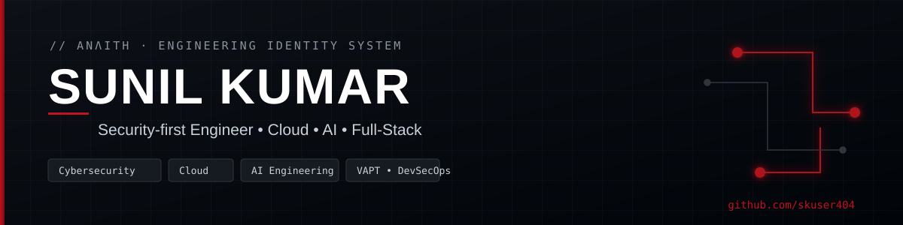

<!-- ╔═══════════════════════════════════════════════════════════╗
     ANΛITH — ENGINEERING IDENTITY SYSTEM · profile: skuser404
     ╚═══════════════════════════════════════════════════════════╝ -->

<a href="https://github.com/skuser404">
  
</a>

<div align="center">

<a href="https://github.com/skuser404"></a>

<br>


&nbsp;

&nbsp;

&nbsp;


[](https://github.com/skuser404)
[](https://linkedin.com/in/gsunilkumarcybersecurity)
[](mailto:gsunilkumar6018@gmail.com)

</div>

---

## `//` ENGINEERING IDENTITY

```
B.Tech — Cloud Technology & Information Security · Jain University, Bengaluru · 2023–2027
```

I design and build systems where **security is a first-class requirement**, not an afterthought.
My work spans offensive security (VAPT, CTF), production full-stack applications, cloud on AWS, and applied AI — including LLM agents.

- 🛡️ **What I build** — secure web/app platforms, security & automation tooling, and AI agents.
- 🧭 **Domains** — Application Security · Cloud Security · DevSecOps · Full-Stack · AI Engineering · IoT.
- 🚀 **Current direction** — deepening offensive security (VAPT) and secure AI/LLM systems.
- 🎓 **Credential** — AWS Certified Developer – Associate.

---

## `//` TECH STACK

<div align="center">

**Languages**
<br>


**Web · Mobile · Backend**
<br>


**Data · Cloud · DevOps**
<br>


**Security · AI · Tools**
<br>

<br><br>


</div>

---

## `//` FEATURED PROJECT

<div align="center">

### ⬢ CDSIMER — Internship Management System &nbsp;`LIVE`

Internship skill-tracking & management platform for a medical institute — student / teacher / HOD
dashboards, analytics, and role-based access. **Live on the Play Store, 200+ users.**

`Flutter` · `Supabase` · `PostgreSQL` · `JWT` · `PWA`

[](https://play.google.com/store/apps/details?id=com.cdsimer.app)

</div>

---

## `//` SELECTED WORK

> Prioritised by evidence. Status labelled honestly — `LIVE` shipped · `DEV` in development · `RESEARCH` experimental · `CONCEPT` planned.

### ⬢ Security & AI

**ScamShield — Scam / Phishing Detection** &nbsp;·&nbsp; `LIVE`
NLP + rule-based system that classifies scam/phishing text, with data validation and evaluation. Won **Best Cybersecurity Project Award (2024)**.
`Python · NLP · Scikit-learn` &nbsp; » add repo link

**Email Intelligence & Automation Platform** &nbsp;·&nbsp; `LIVE`
Self-hosted platform (on AWS) that extracts structured information from unstructured email/text using an LLM and automates workflows.
`Python · LLM API · AWS · PostgreSQL` &nbsp; » add repo link

**ADK Illustration Agent** &nbsp;·&nbsp; `DEV`
LLM agent that generates images from natural-language prompts, with Agent-to-Agent (A2A) communication, prepared for cloud deployment.
`Python · Google ADK · Gemini · GCP` &nbsp; » add repo link

**Secure Fingerprint Authentication — Quantum-Enhanced Deep Learning** &nbsp;·&nbsp; `RESEARCH`
Final-year research exploring quantum-enhanced deep learning for fingerprint recognition with cloud-based security. *Proposed approach — results not yet experimentally validated.*
`Research · Deep Learning · Cloud Security`

### ⬢ Cloud / Full-Stack Products

**AuraSort — File Sorter Dashboard** &nbsp;·&nbsp; `LIVE`
Local file-organiser tool that scans a disk/Downloads folder and auto-sorts media and documents into tidy folders, with an animated live dashboard. Open-source, with a free GitHub Pages demo.
`JavaScript · Web · GitHub Pages` &nbsp; » add repo + demo link

**RentFlow — Property Management Platform** &nbsp;·&nbsp; `DEV`
Rental & property management — tenant lifecycle, financial ledger, maintenance, visitor & inventory management, reminders, analytics.
`Full-Stack` &nbsp; » add repo link

**Anthariksha Trekkers** &nbsp;·&nbsp; `DEV`
Adventure-tourism platform — destination catalogue, trek pages, itineraries, booking enquiries. (Technical Lead & Website Developer.)
`Web · Full-Stack` &nbsp; » add repo link

### ⬢ More

<details>
<summary><b>IoT & Embedded</b> — hardware experiments (expand)</summary>

- **IoT Power Monitoring System** — energy monitoring with microcontrollers & sensors.
- **Smart Road Safety System** — sensor-based road-safety prototype.
- **RFID-based Authentication Experiments** — RC522 access-control trials.

`Arduino · ESP32 · RFID · Sensors` — prototypes / experimental.
</details>

<details>
<summary><b>Collaboration & Concepts</b> (expand)</summary>

**UDAAN** `COLLABORATION` — women's growth & empowerment platform (mentorship, community, safety, AI assistance). *A contribution, not sole ownership.*

**Concepts / prototypes:** AI SDLC Engine (DevSecOps) · Cybersecurity Awareness Game · ConnectX (job portal) · Drug Inventory Management · Face Recognition Attendance · Sign Language Detection · SafeGuard Mobile · Digital DNA Identity `on hold`.

*Listed for direction, not as completed products. A confidential security initiative is also in progress; details withheld under confidentiality.*
</details>

---

## `//` GITHUB ANALYTICS

<div align="center">


</div>

---

## `//` CONTRIBUTION SNAKE

<div align="center">


<sub>Powered by the included <code>.github/workflows/snake.yml</code> Action — it regenerates this graph automatically.</sub>

</div>

<!-- OPTIONAL — LeetCode: uncomment and replace USERNAME only if you have a real LeetCode profile.
## `//` PROBLEM SOLVING
<div align="center">

</div>
-->

---

## `//` ENGINEERING PRINCIPLES

- 🔒 **Security by design** — threat-model early; validate inputs; least privilege by default.
- 📐 **Evidence-based** — claim what is built and verified; label research as research.
- ♻️ **Reliable systems** — own the full lifecycle, from requirements to support.
- ⚙️ **Practical innovation** — build things people actually use, then iterate on real feedback.
- 🧪 **Continuous experimentation** — CTFs, prototypes, and new tools as a learning engine.

---

## `//` CONNECT

<div align="center">

[](https://github.com/skuser404)
&nbsp;[](https://linkedin.com/in/gsunilkumarcybersecurity)
&nbsp;[](mailto:gsunilkumar6018@gmail.com)

<br>


<sub>Design language: <b>ANΛITH — Engineering Identity System</b> · graphite foundation, signal-red accent. Accurate, maintainable, secure.</sub>

</div>
